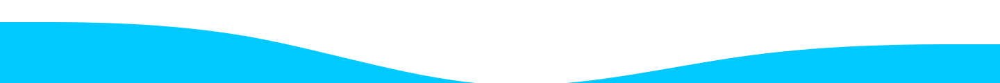

<h1 align="center">Marcos Paulo Rodrigues</h1>

Fullstack Software Developer @ SIBRA TECH · MSc student @ UFSCar

  
  
  
  
  

> _"We've always defined ourselves by the ability to overcome the impossible."_ — Joseph Cooper

---

## About

Fullstack Software Developer at **SIBRA TECH**, building SaaS products and internal platforms end to end. Computer Science graduate from **UFCAT** and Master's student at **UFSCar**.

I like systems that stay simple as they grow, and shipping over polishing forever.

## What I'm working on

- **Backend** — NestJS with CQRS and a layered architecture, Hono for lighter services, MongoDB + Mongoose and PostgreSQL + Drizzle, JWT/Passport and Better Auth, OpenAPI docs.
- **Async** — AWS SQS producers and consumers, scheduled jobs, file processing workers.
- **Python** — FastAPI APIs and standalone SQS consumers, Pydantic, boto3.
- **Frontend** — Next.js and React with TanStack Query, Radix UI, React Hook Form + Zod, Tailwind.
- **Mobile** — Flutter, from the UI to the store release.
- **Infra & quality** — Docker, AWS, Supabase, Turborepo monorepos, Jest and pytest, Sentry.

On the side: a **personal finance SaaS** in TypeScript.

## Stack

| Area             | Technologies                                                                                                                                                                          |
| :--------------- | :------------------------------------------------------------------------------------------------------------------------------------------------------------------------------------ |
| **Mobile**       |                                                                            |
| **Web**          |                                                             |
| **Backend**      |                                                                       |
| **Data & Infra** |  |

## Open source projects

| Project                                                                         | Stack                         | What it is                                                                                                      |
| :------------------------------------------------------------------------------ | :---------------------------- | :-------------------------------------------------------------------------------------------------------------- |
| ⭐ [**UFCAT Serviços**](https://github.com/marcospaulor/ufcat_app)              | Flutter · Firebase            | Cross-platform app centralizing UFCAT news, events, public notices and cafeteria menus for the whole community. |
| 🍽️ [**RU Menu Manager**](https://github.com/marcospaulor/ru-ufcat-menu)         | Next.js · Tailwind · Firebase | Dashboard the RU nutritionist uses to publish the cafeteria menu straight into the mobile app.                  |
| 🕸️ [**UFCAT Web Scraper**](https://github.com/marcospaulor/webscrap-site-ufcat) | Python                        | Collects news, events and public notices from the UFCAT website to feed the app.                                |

## Stats

  <picture>
    <source media="(prefers-color-scheme: dark)" srcset="https://github-profile-summary-cards.vercel.app/api/cards/profile-details?username=marcospaulor&theme=github_dark">
    
  </picture>

  <picture>
    <source media="(prefers-color-scheme: dark)" srcset="https://github-profile-summary-cards.vercel.app/api/cards/most-commit-language?username=marcospaulor&theme=github_dark">
    
  </picture>
  <picture>
    <source media="(prefers-color-scheme: dark)" srcset="https://github-profile-summary-cards.vercel.app/api/cards/stats?username=marcospaulor&theme=github_dark">
    
  </picture>

## Goals

- 🏗️ Ship products that solve real problems.
- 🎓 Finish the Master's and publish the research.
- 🧭 Grow as a leader in tech and innovation.
- 🚀 Start my own tech company.
- 💪 Stay consistent with training and well-being.

## Let's talk

  
  
  

