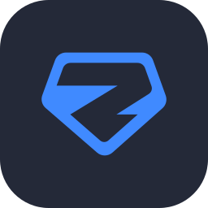
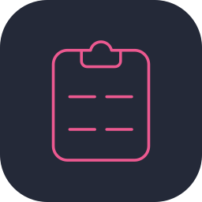
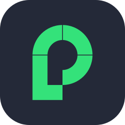

<h1 align="center">Marcos Paulo Rodrigues</h1>

Desenvolvedor de Software Fullstack @ SIBRA Tech · Mestrando na UFSCar

  
  
  
  
  

> *"Sempre nos definimos pela capacidade de superar o impossível."* — Joseph Cooper

---

## Sobre

Desenvolvedor de Software Fullstack na **SIBRA Tech**, construindo produtos SaaS e plataformas internas de ponta a ponta. Graduado em Ciência da Computação pela **UFCAT** e mestrando na **UFSCar**.

Gosto de sistemas que continuam simples enquanto crescem, e de entregar em vez de polir para sempre.

## No que estou trabalhando

- **Backend** — NestJS com CQRS e arquitetura em camadas, Hono para serviços mais leves, MongoDB + Mongoose e PostgreSQL + Drizzle, JWT/Passport e Better Auth, documentação OpenAPI.
- **Assíncrono** — produtores e consumidores AWS SQS, jobs agendados, workers de processamento de arquivos.
- **Frontend** — React com Next.js ou TanStack Start, mais TanStack Query e Router, Radix UI, React Hook Form + Zod, Tailwind.
- **Mobile** — Flutter, da UI à publicação nas lojas.
- **Infra & qualidade** — Docker, AWS, Supabase, monorepos com Turborepo, Jest, Sentry.

Nas horas vagas: um **SaaS de finanças pessoais** em TypeScript.

## Stack

| Área | Tecnologias |
| :-- | :-- |
| **Mobile** |  |
| **Web** |     |
| **Backend** |    |
| **Dados & Infra** |   |
| **Testes & ferramentas** |   |

## Projetos open source

| Projeto | Stack | O que é |
| :-- | :-- | :-- |
| ⭐ [**UFCAT Serviços**](https://github.com/marcospaulor/ufcat_app) | Flutter · Firebase | App multiplataforma que centraliza notícias, eventos, editais e cardápios da UFCAT para toda a comunidade. |
| 🍽️ [**Gerenciador de Cardápio do RU**](https://github.com/marcospaulor/ru-ufcat-menu) | Next.js · Tailwind · Firebase | Dashboard usado pela nutricionista do RU para publicar o cardápio direto no app. |
| 🕸️ [**Web Scraper UFCAT**](https://github.com/marcospaulor/webscrap-site-ufcat) | Python | Coleta notícias, eventos e editais do site da UFCAT para alimentar o app. |
| 💼 [**Portfólio**](https://github.com/marcospaulor/portfolio) | Next.js · TypeScript | Projetos, trabalho e trajetória acadêmica em um só lugar. |

## Estatísticas

  <picture>
    <source media="(prefers-color-scheme: dark)" srcset="https://github-profile-summary-cards.vercel.app/api/cards/profile-details?username=marcospaulor&theme=github_dark">
    
  </picture>

  <picture>
    <source media="(prefers-color-scheme: dark)" srcset="https://github-profile-summary-cards.vercel.app/api/cards/most-commit-language?username=marcospaulor&theme=github_dark">
    
  </picture>
  <picture>
    <source media="(prefers-color-scheme: dark)" srcset="https://github-profile-summary-cards.vercel.app/api/cards/stats?username=marcospaulor&theme=github_dark">
    
  </picture>

## Objetivos

- 🏗️ Entregar produtos que resolvem problemas reais, não demos.
- 🎓 Concluir o mestrado e publicar a pesquisa.
- 🧭 Evoluir como líder em tecnologia e inovação.
- 🚀 Empreender e ter minha própria empresa.
- 💪 Manter constância nos treinos e no bem-estar.

## Vamos conversar

  
  
  

